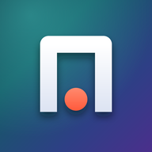

# Персоналка

Приложение тренера: календарь, клиенты, дневник занятий и зарплата в одном месте, плюс веб-кабинет для родителей. Android, затем iPhone; Kotlin Multiplatform, Compose, Ktor, PostgreSQL.

- [План работ](docs/plan.md) — шаги по этапам, отмечены сделанные.
- [ТЗ](docs/tz/README.md) — по разделам, каждый подраздел отдельным файлом.
- [Макеты](docs/mockups/README.md) — экраны этапа 0 в светлой и тёмной теме.
- [Ход работ](PROGRESS.md) — где остановились и что дальше.

## Сборка

Каждый push собирает проект в GitHub Actions: тесты, проверки Android и APK. Свежий APK из ветки `main` — в релизе [«Последняя сборка»](https://github.com/AkenoryGit/personalka/releases/tag/latest-build); он ставится поверх прежней версии, данные сохраняются. Репозиторий открытый (с 08.11.2026): ссылка работает без входа в GitHub, и приложение само находит новую сборку — «Ещё → О приложении → Проверить обновление» (шаг 5.33, читает «Сборка N» в описании релиза).

iPhone (TestFlight) собирается сам после push в `main`, если менялись `iosApp/`, `shared/` или Gradle, — через 20–40 минут сборка в TestFlight; в ветках `step-*` — только проверка архива. Вручную: Actions → «iPhone» → Run workflow. Подробно — [`iosApp/README.md`](iosApp/README.md).

Локально: `./gradlew check :androidApp:assembleDebug` (нужна Java 21 и Android SDK).
